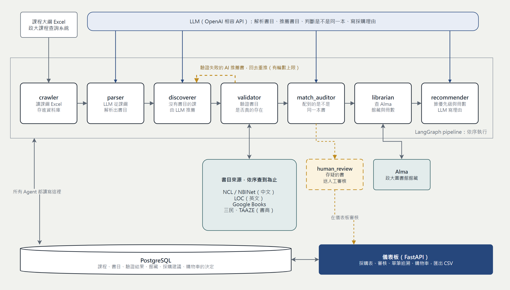
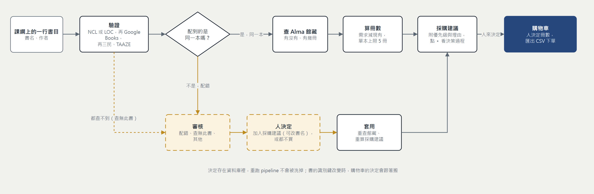

# Library Agent

AI Agent 驅動的課程大綱分析與圖書館採購決策支援系統，專為國立政治大學圖書館設計。

從課程大綱找出指定用書與參考書，驗證書目是否真實存在、確認是否配到同一本書，查詢館藏後算出採購優先級與建議冊數，
最後由採購人員在儀表板上審核、挑選，把決定要買的書放進購物車、匯出成最後的採購清單。

## 系統架構

本系統以 [LangGraph](https://github.com/langchain-ai/langgraph) 建構多 Agent Pipeline：



七個 Agent 依序執行；validator 之後若有 AI 推薦的書驗證失敗，會回到 discoverer 重推（有輪數上限）；存疑的書由 human_review 交給人，在儀表板上處理。

| Agent | 功能 |
|-------|------|
| **crawler** | 從 Excel 課程大綱檔讀取課程資料，存入資料庫 |
| **parser** | 用 LLM 從課綱文字解析出書目（書名、作者、ISBN 等） |
| **discoverer** | 對完全沒有書目的課程，用 LLM 根據課綱內容推薦書目 |
| **validator** | 驗證書目真實性並補齊 ISBN：英文書查 LOC、Google Books；中文書查國家圖書館 NCL／NBINet SRU；都查不到再查書商（目前依序是三民、TAAZE），確認是同一本才算驗證成功 |
| **match_auditor** | 稽核驗證器配到的記錄是不是原書（常見錯誤：書名相同但作者不同的教科書）。配錯的書送人工審核並擋下採購 |
| **librarian** | 查詢 Alma 館藏，確認每本書的館藏狀態與冊數 |
| **recommender** | 以規則算出每本書的採購優先級與建議冊數，再由 LLM 撰寫理由。**同一本書被多門課用到只產生一筆建議**（人數加總、現有館藏只扣一次） |
| **human_review** | 列出信心不足或配對可疑的書目，等待人工處理 |

## 一本書怎麼走到購物車



系統只負責**算出建議**，要不要買、買幾本由人決定：採購表上填冊數或按「加入購物車」才算要買，購物車匯出的 CSV 才是最後的下單清單。
人的決定存在資料庫裡，重跑 pipeline 不會被洗掉。

> 兩張圖的原始檔在 [`docs/images/`](docs/images/)（`.drawio`），用 [diagrams.net](https://app.diagrams.net) 開啟就能編輯。
> 改完內容後可用 `python experiments/render_drawio.py docs/images/<檔名>.drawio` 重新畫成 PNG。

## 環境需求

- Python 3.11+
- Docker（執行 PostgreSQL）
- OpenAI 相容的 LLM API Key（OpenAI 官方，或相容的閘道）
- Alma API Key
- Google Books API Key（選用，用於英文書驗證）

## 安裝

```bash
# 安裝相依套件（含測試工具）
pip install -e ".[dev]"

# 複製環境變數範本
cp .env.example .env
# 編輯 .env，填入 API Keys
```

### `.env` 設定

**金鑰只放在 `.env`，不要寫進程式碼或 commit。**

```env
OPENAI_API_KEY=...
OPENAI_BASE_URL=            # 留空＝OpenAI 官方；使用相容閘道時填它的 /v1 網址
LLM_MODEL=gpt-5.5           # 主模型：解析課綱、探索書目
LLM_MODEL_MINI=gpt-5.4-mini # 輕量呼叫：判斷是否抓 PDF、撰寫採購理由、判斷配對是否同一本
ALMA_API_KEY=...
GOOGLE_BOOKS_API_KEY=       # 選用
```

> 部分新的 reasoning 型模型只接受 `temperature=1`。recommender 與配對稽核使用 `temperature=0`，
> 所以 `LLM_MODEL_MINI` 必須選支援 `temperature=0` 的模型。
> `.env.example` 目前沒有列出 `OPENAI_BASE_URL` 與 `LLM_MODEL_MINI`，需要時請自行加入。

## 啟動資料庫

```bash
# 啟動 PostgreSQL（每次開機後需要執行）
docker-compose up -d

# 第一次使用，或 schema 有變更時，建立／更新資料表
alembic upgrade head
```

## 執行

```bash
# 執行完整 pipeline 並輸出採購報表
library-agent run

# 測試用：只跑前 10 堂課
library-agent run --limit 10

# 只輸出報表（不重跑 pipeline，需先有資料）
library-agent report

# 輸出報表並存成 CSV
library-agent report --output report.csv

# 在終端機逐筆人工審核待處理書目（也可以在儀表板上做）
library-agent review

# 啟動儀表板（預設 http://127.0.0.1:8000）
library-agent dashboard
```

也可以單獨執行各個 Agent，依序為：

```bash
python src/library_agent/agents/crawler.py
python src/library_agent/agents/parser.py
python src/library_agent/agents/parser.py 20    # 測試用，只跑前 20 筆
python src/library_agent/agents/discoverer.py
python src/library_agent/agents/validator.py
python src/library_agent/agents/match_auditor.py
python src/library_agent/agents/librarian.py
python src/library_agent/agents/recommender.py
```

## 儀表板

`library-agent dashboard` 啟動後，在瀏覽器開啟 http://127.0.0.1:8000。頁面分成兩個區域：

**採購**：採購建議表，一列一本書。
- 「系統建議」是參考；「採購冊數」才是你的決定。填冊數或按「加入購物車」就是決定要買，填 0 代表這次不買。
- 可依優先級、類別（指定／參考／AI 推薦）、學系篩選，也能搜尋課程或書名。
- 每列的 ▸ 展開後，會看到這本書的完整決策過程：課綱原文 → 解析結果 → 驗證配對（原書與配到的書並排）→ Alma 館藏 → 冊數怎麼算。

**審核**：處理驗證器沒把握的書，分成「配錯」「查無此書」「其他」與「審核紀錄」。
- 每一列都是同一種操作：書名（預填原書名）加上選填的 ISBN，按「加入採購建議」或「都不買」。
  配到書的列另有「改填配到的書名」可以快速填入。
- 決定後要按上方的「套用並重算採購建議」，放行的書才會重新查館藏並出現在採購建議裡。
- 審核紀錄可以撤銷。

**購物車**：頁首左上角的購物車圖示（數字是全校的書數），點開是整個購物車，不隨學系篩選。
可以改冊數、移出、清空，並匯出成 CSV，那份就是最後要下單的清單。

> 儀表板沒有登入機制，預設只綁定 `127.0.0.1`。要開放給區網使用前，請先加上身分驗證。

## 採購優先級說明

優先級與建議冊數由規則決定，不靠 LLM 猜測：

| | 館藏不存在（或只有書目記錄、無實體） | 有實體館藏但冊數不足 | 足夠，或已有電子書 |
|---|---|---|---|
| **指定用書** | **HIGH** | **MEDIUM** | **SKIP** |
| **參考書** | **MEDIUM** | **LOW** | **SKIP** |

建議冊數 ＝ 需求（選課人數 ÷ 每本可服務人數，無條件進位）− 現有冊數，並套用**單本上限**（預設 5 冊，設定檔 `max_purchase_copies`）。
被上限截斷的書，採購表會在冊數旁標出「（需求 N）」。

## 資料庫管理

```bash
# 查看各 table 筆數
python -c "
from sqlalchemy import select, func
from library_agent.db.models import Course, Citation, VerifiedBook, HoldingCheck, Recommendation
from library_agent.db.session import SessionLocal
with SessionLocal() as s:
    for model in [Course, Citation, VerifiedBook, HoldingCheck, Recommendation]:
        n = s.scalar(select(func.count()).select_from(model))
        print(f'{model.__tablename__}: {n}')
"

# 建立新的 migration（schema 有變更時）
alembic revision --autogenerate -m "描述"
alembic upgrade head
```

## 測試

```bash
pytest
```

測試需要先啟動資料庫（`docker-compose up -d`），不需要網路或真實的 API Key。
會重建或清除全校資料的測試（例如 recommender）使用獨立的測試資料庫（開發庫名稱加 `_test`），不會動到你的資料；
其餘測試則在開發庫播種專用的測試資料，結束後自行清除。

## 注意事項

- `docker-compose down` 資料保留；`docker-compose down -v` **資料全刪**，慎用
- 採購建議（`recommendations`）是推導資料，隨時可以重建；你在購物車裡的決定另存在 `purchase_decisions`，重建不會洗掉
- Google Books API 每日配額 1000 次；中文書走 NCL／NBINet SRU，不佔配額
- LOC（美國國會圖書館）為英文書首選驗證來源，無配額限制
- PostgreSQL 連接埠綁定在 `127.0.0.1:5432`，防止外部存取
- 更完整的設計說明與操作細節（配對稽核、去重規則、審核動作、購物車語意）見 [CLAUDE.md](CLAUDE.md)
